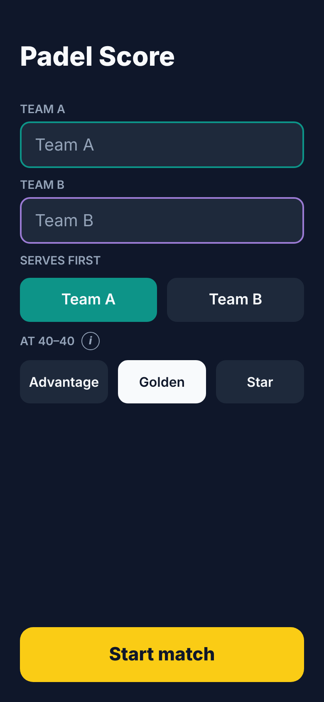
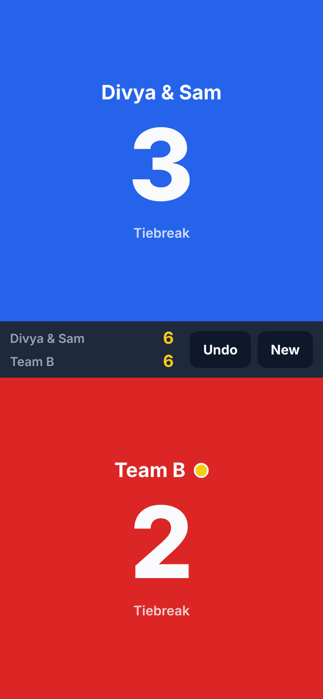
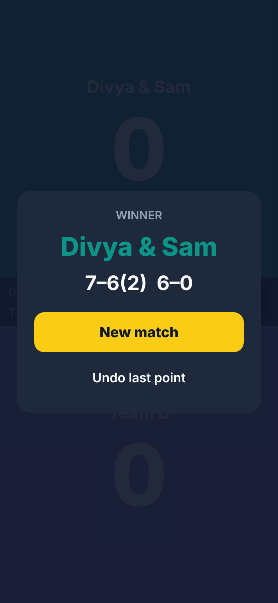

# Padel Battle

A padel scorekeeper for iPhone and Apple Watch.

<p>
  
  
  
  
</p>

## What it does

1. **On the iPhone:** tap **New match**. Pick your court booking from your calendar (for example
   from Playtomic), enter the team names, choose who serves first and the rule at 40–40, then tap
   **Send to watch**.
2. **On the watch:** open Padel Battle and tap the match under **From your phone**. If it isn't
   there, tap **Check phone for a match**. Tap the top or bottom half of the screen to give that
   team the point. **Undo** takes back the last point.
3. **When you stop playing:** tap **✕** → **End match**, or finish the match. Then tap **Sync
   to phone** to save the score to the iPhone's **History**. Matches don't have to be finished.
   **Don't sync** throws the match away.

You can also set up a match on the watch itself, or score on the iPhone with **Play on phone**.
Everything is stored on your devices only.

## Setup

You need a Mac with **Xcode** and a free Apple ID. With a free Apple ID the apps stop working
after **7 days**. Repeat steps 3–4 to reinstall.

**One-time setup**

- In Xcode, add the iPhone and watch platforms:
  `xcodebuild -downloadPlatform iOS` and `xcodebuild -downloadPlatform watchOS`.
- Sign in with your Apple ID in **Xcode → Settings → Accounts**.
- Install XcodeGen: `brew install xcodegen`.
- Turn on **Developer Mode** on the iPhone and on the watch (**Settings → Privacy & Security**).
  The watch needs a passcode for this.

**Install or update**

1. Get the latest code:
   ```bash
   git clone https://github.com/divyasingh77488/padel-score.git   # first time only
   cd padel-score
   git checkout main
   git pull
   ```
2. Generate and open the Xcode project:
   ```bash
   cd apple
   xcodegen
   open PadelScore.xcodeproj
   ```
3. **iPhone:** plug it in and unlock it. In Xcode, choose the **PadelScorePhone** scheme and
   **your iPhone**, then press **▶**.
4. **Watch:** wear it, unlock it and keep it near the phone. Choose the **PadelScoreWatch**
   scheme and **your Apple Watch**, then press **▶**.
5. If the iPhone says the developer isn't trusted, go to **Settings → General → VPN & Device
   Management** and trust your Apple ID.

Tip: on the watch, set **Settings → General → Return to Clock → Padel Battle → After 1 hour** so
the score stays on screen during a match.

If the watch won't connect or install, see [`apple/README.md`](apple/README.md).
